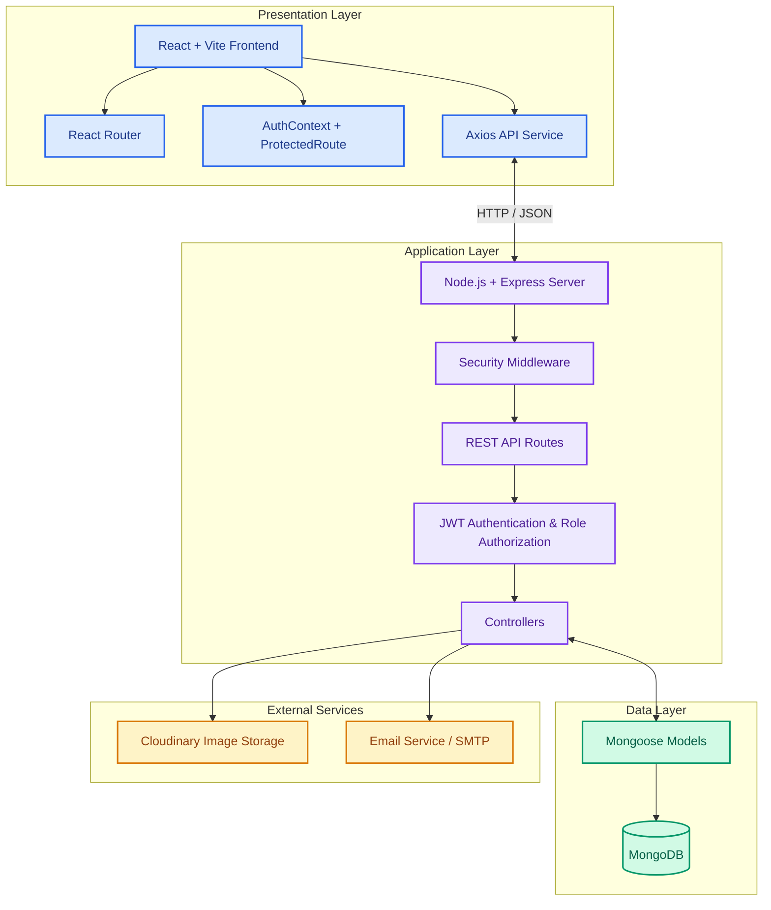
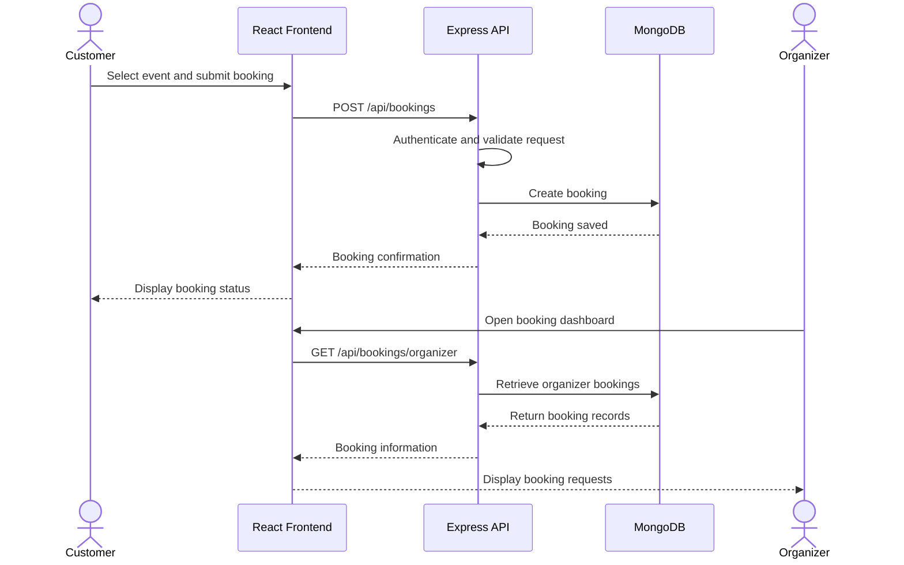

# GatherGrid — Event Discovery & Booking Platform

<p align="center">
  
</p>

<p align="center">
  <strong>Discover. Connect. Celebrate.</strong>
</p>

<p align="center">
  A full-stack event discovery and booking platform connecting customers with event organizers through a seamless, role-based experience.
</p>

<p align="center">
  
  
  
  
  
</p>

---

## Overview

GatherGrid is a full-stack web application designed to simplify event discovery, organizer management, and event booking.

The platform enables customers to explore event listings, discover services and packages, and submit booking requests. Event organizers can manage their listings and respond to customer bookings, while administrators oversee users and organizer approvals.

The application is built using the MERN stack and follows a modular client-server architecture with RESTful APIs, MongoDB persistence, and role-based access control.

## ✨ Key Features

<table>
  <tr>
    <td width="50%">
      <h3>🎟️ Event Discovery</h3>
      Browse event categories, search listings, explore featured events, and view detailed event information.
    </td>
    <td width="50%">
      <h3>📅 Booking Management</h3>
      Submit booking requests, select packages, track booking status, and manage personal bookings.
    </td>
  </tr>
  <tr>
    <td width="50%">
      <h3>🏢 Organizer Dashboard</h3>
      Create, update, and manage event listings, upload images, and respond to customer booking requests.
    </td>
    <td width="50%">
      <h3>🛡️ Admin Dashboard</h3>
      Manage users, approve or reject organizers, and oversee booking operations.
    </td>
  </tr>
  <tr>
    <td width="50%">
      <h3>🔐 Secure Authentication</h3>
      JWT-based authentication, password hashing, email OTP verification, and protected routes.
    </td>
    <td width="50%">
      <h3>☁️ Cloud Integration</h3>
      Cloudinary image storage and email-based verification and password recovery.
    </td>
  </tr>
</table>

## 🖥️ Application Screenshots

Add screenshots of your actual application to the `screenshots/` directory.

| Home Page | Event Discovery |
|---|---|
|  |  |

| Event Details | Customer Dashboard |
|---|---|
|  |  |

| Organizer Dashboard | Admin Dashboard |
|---|---|
|  |  |

> Replace these image paths with your actual screenshots. The screenshots directory and image files must exist in your repository for the images to display.

## 🏗️ System Architecture

GatherGrid follows a three-tier architecture:

1. **Presentation Layer:** React frontend for user interaction and navigation.
2. **Application Layer:** Node.js and Express backend for API handling, authentication, authorization, and business logic.
3. **Data Layer:** MongoDB for persistent storage, with Cloudinary and email services for external integrations.



### Architecture Components

| Component | Responsibility |
|---|---|
| React + Vite | Renders the frontend and handles user interaction |
| React Router | Manages application navigation |
| Axios | Sends HTTP requests to the backend |
| Express.js | Defines and handles REST API endpoints |
| Authentication Middleware | Verifies JWTs and identifies users |
| Authorization Middleware | Enforces user roles and organizer approval |
| Mongoose | Defines schemas and communicates with MongoDB |
| MongoDB | Stores users, events, bookings, categories, and OTP records |
| Cloudinary | Stores uploaded event images |
| Nodemailer | Sends email verification and password reset OTPs |

## 🔄 Booking Workflow



## 🛠️ Technology Stack

<table>
  <tr>
    <th>Category</th>
    <th>Technologies</th>
  </tr>
  <tr>
    <td>Frontend</td>
    <td>React, Vite, React Router, Axios, JavaScript, HTML5, CSS3</td>
  </tr>
  <tr>
    <td>Backend</td>
    <td>Node.js, Express.js, REST APIs</td>
  </tr>
  <tr>
    <td>Database</td>
    <td>MongoDB, Mongoose</td>
  </tr>
  <tr>
    <td>Authentication</td>
    <td>JWT, bcryptjs, OTP verification</td>
  </tr>
  <tr>
    <td>Cloud Services</td>
    <td>Cloudinary, Nodemailer</td>
  </tr>
  <tr>
    <td>Security</td>
    <td>Helmet, CORS, Express Rate Limit, Authorization Middleware</td>
  </tr>
  <tr>
    <td>Development</td>
    <td>Git, GitHub, npm, Nodemon, ESLint</td>
  </tr>
</table>

## 👥 User Roles

### Customer
- Register and verify email.
- Browse and search event listings.
- View event details, services, and packages.
- Submit and manage booking requests.
- Track booking status.

### Event Organizer
- Register as an organizer.
- Complete email verification and await administrator approval.
- Create and manage event listings.
- Upload event images.
- View customer booking requests and update their status.

### Administrator
- Manage registered users.
- Approve or reject organizer accounts.
- Manage user account status.
- View and manage bookings.

## 📁 Project Structure

```text
GatherGrid/
│
├── frontend/
│   ├── public/
│   ├── src/
│   │   ├── assets/
│   │   ├── components/
│   │   ├── context/
│   │   ├── pages/
│   │   ├── services/
│   │   ├── App.jsx
│   │   └── main.jsx
│   ├── package.json
│   └── vite.config.js
│
├── backend/
│   ├── config/
│   ├── controllers/
│   ├── middleware/
│   ├── models/
│   ├── routes/
│   ├── scripts/
│   ├── utils/
│   ├── server.js
│   └── package.json
│
├── screenshots/
├── .gitignore
└── README.md
```

## 🚀 Getting Started

### Prerequisites

- Node.js and npm
- MongoDB database or MongoDB Atlas
- Cloudinary account
- SMTP email credentials

### 1. Clone the repository

```bash
git clone <YOUR_GITHUB_REPOSITORY_URL>
cd GatherGrid
```

### 2. Install backend dependencies

```bash
cd backend
npm install
```

### 3. Configure backend environment variables

Create a `.env` file inside the `backend` directory.

```env
PORT=5000
CLIENT_URL=http://localhost:5173

MONGO_URI=your_mongodb_connection_string
JWT_SECRET=your_secure_jwt_secret

CLOUDINARY_CLOUD_NAME=your_cloud_name
CLOUDINARY_API_KEY=your_cloudinary_api_key
CLOUDINARY_API_SECRET=your_cloudinary_api_secret

EMAIL_USER=your_email_address
EMAIL_PASS=your_email_app_password
```

### 4. Start the backend

```bash
npm run dev
```

### 5. Install frontend dependencies

Open another terminal.

```bash
cd frontend
npm install
```

### 6. Configure the frontend

Create a `.env` file inside the `frontend` directory.

```env
VITE_API_URL=http://localhost:5000/api
```

### 7. Start the frontend

```bash
npm run dev
```

Open the URL displayed by Vite in your browser.

## 🔐 Security

GatherGrid implements:

- Password hashing using bcryptjs.
- JWT-based authentication.
- Role-based authorization.
- Organizer approval checks.
- OTP expiration and hashed OTP storage.
- Rate limiting for authentication endpoints.
- Helmet security headers.
- CORS configuration.
- Protected frontend routes.
- Environment variables for sensitive credentials.

## 🗺️ Future Enhancements

- Online payment gateway integration.
- Booking confirmation notifications.
- Customer reviews and ratings.
- Booking calendar and availability management.
- Automated booking reminders.
- Advanced search and filtering.
- Automated API documentation using Swagger.
- Unit and integration testing.
- Production deployment and CI/CD automation.

## 📌 Project Status

GatherGrid has been developed as a full-stack event discovery and booking application with customer, organizer, and administrator workflows.

The project demonstrates practical full-stack development concepts including REST API design, database modeling, authentication, authorization, file uploads, and role-based application workflows.

---

<p align="center">
  <strong>GatherGrid — Discover. Connect. Celebrate.</strong>
</p>

<p align="center">
  Built with React, Node.js, Express, and MongoDB.
</p>
